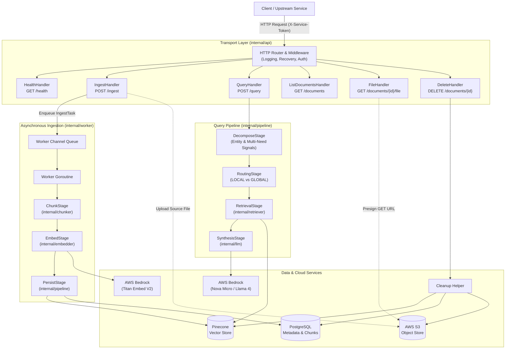

# Quarry

Quarry (`quarry-rag`) is a domain-agnostic retrieval-augmented generation (RAG) microservice written in Go. It provides HTTP endpoints for backend applications and distributed services to ingest textual documents (raw JSON or multipart PDF, DOCX, DOC files), generate vector embeddings, persist document metadata, and answer natural-language queries grounded in the indexed corpus.

## Features

- **Document ingestion**: Accepts raw text via JSON or binary files (PDF, DOCX, DOC) via multipart upload, with SHA-256 fingerprint deduplication.
- **Adaptive retrieval**: Evaluates query complexity and similarity signals to route between LOCAL and GLOBAL vector search in Pinecone.
- **Tenant and document filtering**: Supports metadata filtering by document type and query-time document ID allowlists enforced before synthesis.
- **Grounded synthesis**: Generates answers in the language of the incoming question using AWS Bedrock models when evidence is available; empty results return a fixed English no-information answer without synthesis.
- **Offline development mode**: Runs fully offline with deterministic in-memory vector storage and mock model providers via `GO_RAG_FAKE_MODE`.
- **Service authentication**: Restricts operational and query routes with constant-time `X-Service-Token` verification.

## Architecture Overview



## Quick Start

### Offline Fake Mode

Offline fake mode executes the service without cloud credentials by using an in-memory vector store, deterministic mock embeddings, and local model synthesis. A PostgreSQL database is still required for schema migrations and metadata storage.

1. Start a local PostgreSQL instance:

```sh
docker run --detach --name rag-dev-db \
  --env POSTGRES_DB=rag \
  --env POSTGRES_USER=rag \
  --env POSTGRES_PASSWORD=rag \
  --publish 127.0.0.1:5432:5432 \
  postgres:16.13-alpine3.23
```

2. Run the service from source:

```sh
export GO_RAG_FAKE_MODE=true
export DATABASE_URL="host=127.0.0.1 port=5432 user=rag password=rag dbname=rag sslmode=disable"
export SERVICE_TOKEN="dev-token"
go run ./cmd/server
```

### Docker Execution

To run the containerized application using Docker Compose:

1. Copy the example configuration:

```sh
cp .env.example .env
```

Set `S3_BUCKET=your-owned-bucket` in `.env` for original file storage, and optionally set `S3_EXPECTED_BUCKET_OWNER` to the owner's 12-digit AWS account ID. Leaving `S3_BUCKET` empty disables original file storage.

2. Start the container in detached mode:

```sh
docker-compose up --build -d
```

## Minimal Examples

### Ingest a Document

```sh
curl -X POST localhost:8081/ingest \
  -H "X-Service-Token: dev-token" \
  -H "Content-Type: application/json" \
  -d '{
    "content": "The storage engine distributes records across replicated partitions for fault tolerance.",
    "doc_type": "technical_spec"
  }'
```

### Query the Corpus

```sh
curl -X POST localhost:8081/query \
  -H "X-Service-Token: dev-token" \
  -H "Content-Type: application/json" \
  -d '{
    "query": "How does the storage engine achieve fault tolerance?",
    "mode": "auto"
  }'
```

## Limits and Local Checks

JSON ingestion accepts at most 1,000,000 bytes of decoded content. Its request-body cap is 8,097,152 bytes, allowing sixfold JSON escaping plus metadata overhead; queries accept a 1 MiB body. Every upload format enforces the same decoded-text limit. PDF extraction also enforces an 8 MiB decoded-stream budget. Oversized bodies return 413; extraction-limit failures return 422.

The runtime image uses numeric UID/GID `10001:10001`. A failed automatic routing probe falls back to GLOBAL retrieval. If no authorized evidence remains, queries return `No relevant information was found to answer this question.` with zero synthesis token usage and no model call.

With Go 1.27.3, golangci-lint and Docker available, run the full host checks and build:

```sh
make ci
```

`make test` runs the full race suite and needs a Docker daemon for isolated database tests. The Docker `test` stage runs the short suite without a daemon. Delete explicit documents with `make cleanup IDS="<uuid> <uuid>"`.

## Documentation

| Document | Description |
|---|---|
| [Architecture](docs/architecture.md) | Package organization, sequence diagrams, database entity-relationship model, and runtime lifecycles |
| [API Reference](docs/api.md) | Route definitions, authentication headers, request and response structures, and HTTP status codes |
| [Configuration](docs/configuration.md) | Environment variables, validation constraints, default parameters, and database schema migrations |
| [Deployment](docs/deployment.md) | Container image build, non-root user execution, external service requirements, and token rotation |
| [Development](docs/development.md) | Repository directory structure, unit and integration test suites, operational scripts, and fake mode mechanics |

For code contribution guidelines and security disclosure policies, refer to CONTRIBUTING.md and SECURITY.md.

## License

MIT, see LICENSE
