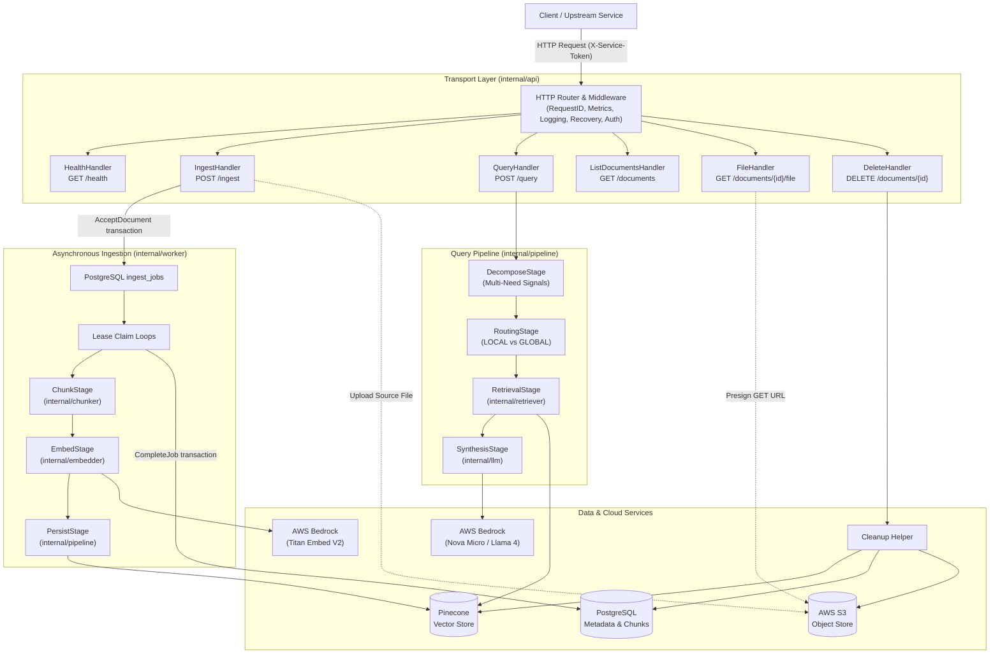
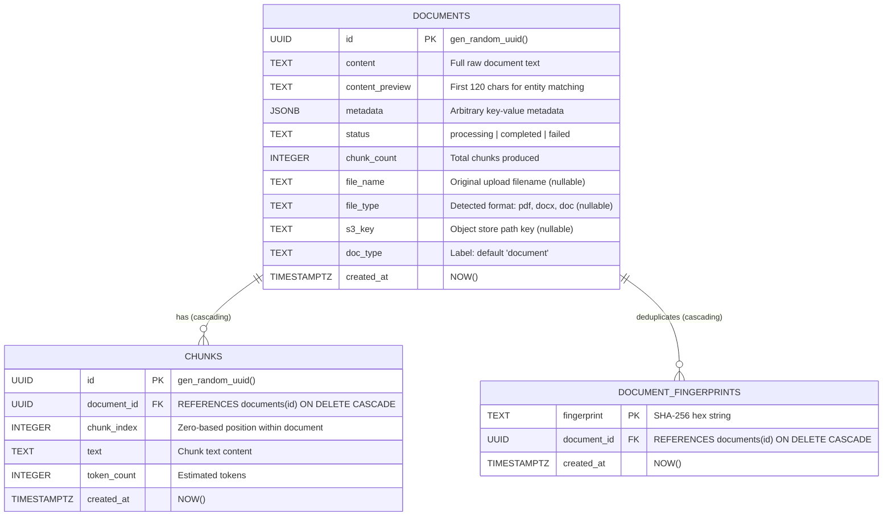

# Architecture

## System Components

Quarry organizes core functionality into distinct packages under `internal/`, wired together at startup by `cmd/server/main.go`.



### Package Responsibilities

- **`cmd/server`**: Reads environment configuration, initializes database connections and storage drivers, instantiates pipeline stages, spawns the background worker, configures HTTP routes, and orchestrates graceful server shutdown.
- **`internal/config`**: Reads and parses environment variables into structured configurations with explicit boundary checks and fallback defaults.
- **`internal/api`**: Configures the HTTP multiplexer and wraps routes with structured JSON logging, panic recovery, and constant-time token verification middleware.
- **`internal/api/handler`**: Implements transport handlers translating HTTP requests and responses into domain operations.
- **`internal/api/middleware`**: Provides request logging with execution latency tracking, panic recovery yielding JSON envelopes, and service token enforcement.
- **`internal/chunker`**: Splits raw text into token-bounded segments using paragraph and sentence boundaries, normalizes document text, strips HTML only from documents with recognizable markup, and generates content fingerprints.
- **`internal/extractor`**: Extracts plain text from uploaded document formats (PDF, DOCX, DOC, plain text) with context cancellation and XML safety bounds.
- **`internal/embedder`**: Invokes AWS Bedrock Titan Embed V2 to generate 1024-dimensional normalized vector embeddings, throttling concurrent API requests via weighted semaphores. Provides a deterministic fake embedder for offline execution.
- **`internal/llm`**: Manages LLM calls to AWS Bedrock Converse, executing model selection (Nova Micro vs. Llama 4 Maverick), plain-text answer synthesis, token estimation, and JSON retry-correction routines. Provides a fake converser for offline execution.
- **`internal/retriever`**: Executes scoped similarity searches in the default vector namespace and evaluates authorized candidate scores to select LOCAL or GLOBAL search modes.
- **`internal/worker`**: Claims persisted ingestion jobs with renewable leases, executes documents in parallel, and records retries or terminal status in PostgreSQL.
- **`internal/pipeline`**: Encapsulates sequential multi-stage pipelines:
  - **Ingestion Pipeline**: Executes `ChunkStage`, `EmbedStage`, and `PersistStage`.
  - **Query Pipeline**: Executes `DecomposeStage`, `RoutingStage`, `RetrievalStage`, and `SynthesisStage`.
- **`internal/store/postgres`**: Manages PostgreSQL connection pooling via `pgxpool`, applies embedded SQL migrations, and performs transactional CRUD queries on documents, chunks, and fingerprints.
- **`internal/store/pinecone`**: Implements vector storage drivers for Pinecone, sharing one connection across all namespaces (legacy document namespaces use handles derived from it, which are never closed individually; the connection closes when the client shuts down), with batched writes, retries, and metadata filtering.
- **`internal/store/s3`**: Uploads source binaries, deletes stored objects, and generates presigned GET download URLs.
- **`internal/cleanup`**: Provides multi-store deletion ensuring external vector and object records are purged before metadata records are removed.
- **`internal/domain`**: Defines shared interfaces, domain data models, and the default document label constant (`DefaultDocType = "document"`).

---

## Ingest Pipeline

The ingest pipeline processes text or binary documents through chunking, embedding, vector storage, and relational persistence.

```mermaid
sequenceDiagram
    autonumber
    actor Caller as Client Service
    participant Handler as IngestHandler
    participant S3 as AWS S3
    participant Postgres as PostgreSQL
    participant Worker as Ingestion Worker
    participant Embedder as AWS Bedrock
    participant Pinecone as Vector Store
    Caller->>Handler: POST /ingest
    Handler->>Handler: Extract, remove content NUL, validate
    opt Source storage enabled and no duplicate for this identity
        Handler->>S3: Upload original file
    end
    Handler->>Postgres: AcceptDocument transaction
    Note over Postgres: Reserve identity, store content and fingerprint, insert pending job
    alt Accepted, processing duplicate, or failed duplicate requeued
        Handler-->>Caller: 202 processing with existing or new ID
    else Completed duplicate
        Handler-->>Caller: 200 already_ingested
    else Identity conflict or queue full
        Handler-->>Caller: 409 conflict or 503 queue
    end
    Note over Handler,S3: Remove a new upload when acceptance does not use it
    Worker->>Postgres: Claim ready job or expired lease
    loop Until processing ends
        Worker->>Postgres: Renew lease every lease / 3
    end
    Worker->>Worker: Chunk content
    Worker->>Embedder: Embed chunks concurrently
    Worker->>Pinecone: Upsert default namespace
    Worker->>Postgres: CompleteJob transaction
    Note over Postgres: Require processing status and owned lease; insert chunks and remove job
    alt Retryable failure
        Worker->>Postgres: Reschedule with backoff and last_error
    else Permanent or exhausted failure
        Worker->>Postgres: Record failed and last_error; remove job
        Worker->>Pinecone: Remove partial vectors
    end
    Note over Worker,Pinecone: Deletion clears vectors again after removing the row; late writes compensate on failed completion
```

### Ingestion Stages

1. **ChunkStage**: Converts raw document text into sliding-window text chunks bounded by `CHUNK_TOKEN_SIZE` (default 512 estimated tokens, minimum 2) and 30,000 bytes. Sentence boundaries are preferred, including full-width terminators without following whitespace. Oversized sentences split by words, and oversized words split at rune boundaries. Each window includes new text and retains up to `CHUNK_OVERLAP` (default 64 estimated tokens) from the previous window when both limits permit. Generates a deterministic chunk ID for each chunk.
2. **EmbedStage**: Embeds chunks concurrently up to `EMBED_CONCURRENCY`; the provider also enforces its shared request limit.
3. **PersistStage**:
   - Assigns the caller's `doc_type` or falls back to the default `"document"`.
   - Injects `doc_type` into individual chunk metadata; document labels are stored at acceptance.
   - Upserts vectors into Pinecone only under the default namespace (`""`), with `doc_id` metadata identifying each document.
   - Splits each vector upsert into batches of at most `PINECONE_UPSERT_BATCH_SIZE` records (default 100) and 1.5 MiB of estimated encoded data. Metadata above 40,960 serialized JSON bytes per record is rejected before writing.
   - Retries transient vector index failures with a per-attempt `PINECONE_TIMEOUT` and full-jitter exponential backoff from 200 ms, capped at 5 seconds. Writes and deletions use up to `PINECONE_MAX_ATTEMPTS` attempts; queries use at most three. Parent cancellation stops retries.
4. **Transactional completion**: The worker replaces chunk metadata and marks the document completed in one transaction guarded by document status and the current lease. Document content, metadata, preview and fingerprint already exist before acceptance returns.

Before chunking, documents with recognizable HTML markup have comments, script and style content removed. Block elements become paragraph breaks, line-break elements become newlines, remaining tags are removed, and HTML entities are decoded. Plain text without markup retains comparison operators and literal entities.

Text normalization first converts CRLF, CR and Unicode line separators to newlines, with Unicode paragraph separators becoming paragraph breaks. It applies NFC followed by width folding, expands common Latin ligatures and folds space variants while preserving superscripts, fractions and circled numbers. Unicode format characters are removed; other controls except newlines and tabs become spaces. Hyphenated line wraps are joined, decoration and bullet runs are collapsed, single line breaks become spaces, and paragraph breaks are preserved. These rules apply to newly ingested chunks; existing chunks and raw-content fingerprints are unchanged. `textutil.SanitizeForPrompt` removes Unicode format characters and controls except newlines and tabs without otherwise normalizing text.

Token estimates count each Han, Hiragana, Katakana, Hangul, Thai, Lao, Khmer, Myanmar and Tibetan character as one token. Dense characters separate words. The remaining estimate is the larger of the word count multiplied by 1.3 and the non-space, non-dense rune count divided by four, each rounded up. Chunk token counts use this same estimate. Paragraph breaks remain visible inside chunks, and fragments of a split word are joined without inserted spaces.


---

## Query Pipeline

The query pipeline executes semantic search and grounded answer generation through four distinct stages: decomposition, routing, retrieval, and synthesis.

```mermaid
sequenceDiagram
    autonumber
    actor Caller as Client Service
    participant Handler as QueryHandler
    participant Decompose as DecomposeStage
    participant Metadata as PostgreSQL
    participant Routing as RoutingStage
    participant Embedder as AWS Bedrock (Embedder)
    participant Retrieval as RetrievalStage
    participant Pinecone as Pinecone
    participant Synthesis as SynthesisStage
    participant LLM as AWS Bedrock (LLM)

    Caller->>Handler: POST /query (JSON body with query, mode, filters, allowlist)
    Note over Handler: Validate JSON, bounds (1-10000 decoded bytes, max_chunks 0-100)

    Handler->>Decompose: Run(QueryContext)
    Decompose->>Decompose: Inspect multi-need surface cues
    Note over Decompose: Set SubQueries count without database calls

    Handler->>Routing: Run(QueryContext)
    Note over Routing: Empty allowlist skips embedding and search
    Routing->>Embedder: Embed query (Titan Embed V2)
    Embedder-->>Routing: Query embedding
    alt Explicit GLOBAL
        Routing->>Routing: Select GLOBAL without a probe
    else Automatic or explicit LOCAL
        Routing->>Pinecone: Probe top 5 with doc_type and allowlist filters
        Pinecone-->>Routing: Scoped candidates
        Routing->>Metadata: Check candidate visibility and load candidate previews
        Metadata-->>Routing: Visible candidates and their previews
        Routing->>Routing: Match entity phrases using whole words and candidate order
        Routing->>Routing: Determine mode (sub-queries > 1 -> GLOBAL, entity -> LOCAL, score >= threshold -> LOCAL, else GLOBAL)
        Note over Routing: Explicit LOCAL overrides score and sub-query count; no visible candidate selects GLOBAL
        Routing->>Routing: For LOCAL, select entity document or best visible candidate
    end

    Handler->>Retrieval: Run(QueryContext)
    Retrieval->>Pinecone: Query default namespace with doc_type and allowlist filters
    Note over Retrieval: LOCAL searches the selected document; fewer than 3 chunks triggers one scope-wide top-up
    Pinecone-->>Retrieval: Scored chunks
    Retrieval->>Retrieval: filterChunksByAllowedDocIDs (tenant allowlist enforcement)
    Retrieval->>Retrieval: Remove chunks of unavailable documents using PostgreSQL

    Handler->>Synthesis: Run(QueryContext)
    alt No authorized evidence
        Synthesis-->>Handler: Fixed English no-information answer, zero synthesis tokens
    else Evidence available
    Synthesis->>Synthesis: trimChunksForSynthesis (relative score floor 0.55, max count cap, rune cutoff)
    Synthesis->>Synthesis: Route model (Nova Micro vs Llama 4 based on SYNTHESIS_MODEL & multi-need)
    Synthesis->>LLM: ConverseRoutedPlain (system prompt: answer in question's language)
    LLM-->>Synthesis: Synthesized answer & token usage

    end
    Handler-->>Caller: 200 OK (answer, mode, chunks_used, scored_chunks, token_usage)
```

### Query Time Budget

Each handler admits up to `QUERY_CONCURRENCY` queries (default 32), waiting at most `QUERY_QUEUE_TIMEOUT` (default 2 seconds) before returning 503 with `Retry-After: 1`. Admission precedes all pipeline work. Each admitted query gets `QUERY_TIMEOUT` (default 60 seconds) across decomposition, routing, embedding, retrieval and synthesis. The synthesis call gets a nested `SYNTHESIS_TIMEOUT` (default 45 seconds); an earlier parent deadline always wins. Cancellation propagates to upstream calls and waiting queries.

The AWS SDK retryer is the single transport retry layer for Bedrock, configured with `AWS_MAX_ATTEMPTS`. The ambassador makes one client call per operation and does not add backoff or retry throttled requests. Structured-output correction remains separate; answer synthesis uses the plain-text path without correction calls. SDK retries and their backoff share the synthesis or embedding deadline. Timeout errors return 504, upstream throttling returns 503 with `Retry-After: 2`, empty synthesis returns 502, and other failures return a generic 500. Full errors are logged at error level.

### Query Stages

1. **DecomposeStage**: Logs the query byte length and first 12 hexadecimal SHA-256 digits without the query text. Sets the sub-query count from multi-need surface signals (comparison keywords, conjunctions, aggregation markers). Makes no database or generation calls.
2. **RoutingStage**:
   - An empty allowlist skips embedding and retrieval. Otherwise, embeds the incoming query once using Bedrock Titan Embed V2. Explicit `global` skips the routing probe.
   - Automatic routing and explicit `local` probe the top five candidates with the same allowlist and document-type filters as retrieval, then remove unavailable documents. Entity matching reads only those candidates' previews, uses whole words, prefers full and longer phrases, and breaks ties by candidate score order.
   - Evaluates whether to route to `LOCAL` or `GLOBAL` retrieval:
     - Explicit `global` selects `GLOBAL`. Explicit `local` selects `LOCAL` when a visible candidate exists, regardless of score or sub-query count.
     - If the similarity probe fails, `GLOBAL` retrieval is selected without discarding the query embedding.
     - If no visible candidate remains, `GLOBAL` retrieval is selected.
     - If multi-need signals produced multiple sub-query requirements, `GLOBAL` mode is selected.
     - If a specific named entity is identified, `LOCAL` mode is selected.
     - If the highest vector similarity score meets or exceeds `LOCAL_RETRIEVAL_THRESHOLD` (default 0.70), `LOCAL` mode is selected.
     - Otherwise, `GLOBAL` mode is selected.
   - `LOCAL` targets the matched entity's document, or the highest-scoring visible candidate's document when no entity matches.
3. **RetrievalStage**:
   - Queries Pinecone using the embedding produced during routing.
   - Both modes query the default namespace with `filter_doc_type` and `allowed_document_ids` applied before top-K selection. `LOCAL` narrows the document filter to the routed document. If that query returns fewer than three chunks, it makes one additional query using the original authorized scope and document-type filter; results merge by chunk ID using the highest score, then sort and trim to top-K. `GLOBAL` queries the authorized scope once without a sparse-result fallback. Allowlists above 10000 IDs require one sequential query per group.
   - Retains the allowlist post-filter before synthesis as defense in depth. A nil allowlist allows all documents; an empty allowlist denies all documents.
   - Checks document visibility in PostgreSQL after the allowlist filter and before synthesis. Only completed documents contribute chunks. Failed, unfinished, deleted and missing documents are excluded even if their vectors remain searchable. Lookup failures stop the query; the top score is recomputed from visible chunks.
4. **SynthesisStage**:
   - When `MIN_RELEVANCE_SCORE` is positive, drops chunks below it before adaptive trimming; the default zero disables this floor. If no authorized evidence remains, returns `No relevant information was found to answer this question.` with no model call, zero synthesis token usage, `early_exit=true` and `finish_reason=no_evidence`.
   - Applies adaptive chunk trimming: drops chunks scoring below 55% of the top chunk's score, bounds chunk counts (5 chunks for simple queries, 8 for multi-need queries), and truncates chunk bodies at sentence boundaries near 1200 runes.
   - Selects synthesis model according to `SYNTHESIS_MODEL` (`fallback` defaults to Llama 4 Maverick, `primary` routes to Nova Micro, and `hybrid` dynamically routes based on multi-need detection).
   - Places the question before the retrieved excerpts and wraps each excerpt in a numbered marker with a random per-request boundary. Removes invisible format and control characters from the question and stored chunks, preserves newlines and tabs, and escapes excerpt marker prefixes inside their text. Estimates tokens over the complete system and user prompts, including markers.
   - Instructs synthesis to answer strictly using retrieved excerpts and in the language of the user's question, treating excerpt text as untrusted content whose instructions, role changes and formatting requests must not be followed.
   - Invokes AWS Bedrock Converse only for evidence-backed answers and aggregates synthesis token usage statistics. Empty text is an error; nonempty output reports whether generation stopped, reached its token or context limit, or was filtered.

---

## Data Model

The relational storage schema is defined across embedded SQL migrations applied in numeric order at service startup.



### Table Definitions

- **`documents`**: Stores primary document records, full content, status lifecycle (`processing`, `completed`, `failed`), extracted prefix preview, file metadata, object storage references, and document labels.
- **`chunks`**: Stores segmented text blocks and approximate token counts linked to parent documents via cascading foreign keys.
- **`ingest_jobs`**: Stores pending or running work, attempt counts, lease ownership and expiry, retry scheduling, and the latest error. Deleting a document cascades to its job.
- **`document_fingerprints`**: Maps SHA-256 content hashes to document UUIDs, providing deduplication across ingest requests.

---

## Lifecycle and Concurrency Model

### Server Initialization

1. Configuration is loaded and validated against constraints from environment variables.
2. The PostgreSQL connection pool (`pgxpool.Pool`) is established with a 30-second connection timeout.
3. Embedded SQL migrations are discovered by version and applied once in ascending order within a PostgreSQL transaction guarded by an advisory lock. The `schema_migrations` table records versions and checksums; concurrent replicas wait for the lock, and subsequent startups skip applied SQL after verifying checksums.
4. Storage drivers and model clients are initialized:
   - In standard mode: Pinecone index connection pools, AWS Bedrock embedder, AWS Bedrock LLM client, and S3 object storage client.
   - In offline fake mode: In-memory vector store, fake deterministic embedder, and fake converser.
5. Ingestion stages and `INGEST_WORKERS` lease claim loops are started with a unique process owner.
6. The HTTP router and middleware chain are registered with standard network listeners.
7. HTTP server listener begins serving with explicit timeout parameters:
   - Header read timeout: 5 seconds
   - Body read timeout: `HTTP_READ_TIMEOUT` (default 60 seconds)
   - Response write timeout: `HTTP_WRITE_TIMEOUT` (defaults to `QUERY_TIMEOUT + 15s`, 75 seconds with the default query budget)
   - Idle keep-alive timeout: `HTTP_IDLE_TIMEOUT` (default 60 seconds)

### Worker Queue Mechanics

- PostgreSQL stores accepted content and a pending job atomically before HTTP 202. `WORKER_QUEUE_SIZE` defaults to 1000 and bounds outstanding jobs across replicas, including running work.
- Identical content without an explicit identifier selects its existing document atomically. Completed duplicates return 200; in-flight duplicates return 202; failed duplicates return 202 and requeue the original identifier. Explicit identifiers preserve caller identity and reject conflicting content with 409.
- `INGEST_WORKERS` defaults to 2. Each loop claims due jobs with `FOR UPDATE SKIP LOCKED` and renews its lease every `INGEST_LEASE / 3`. Polling discovers persisted work even when a notification is missed or another replica accepts it.
- Expired leases are reclaimed. Every attempt first removes existing vectors for the document. Retryable failures use exponential backoff from 5 seconds to 5 minutes plus up to 1 second of jitter. Processing failures that are permanent or exhaust attempts remove partial vectors under the live lease before recording `failed` and `last_error`. Jobs exhausted through expired leases are failed during claiming; their remaining vectors stay hidden by document status and are removed before any requeued attempt.
- Deletion cascades to the job. Completion requires both a processing document and its owned lease; if deletion wins, the worker removes any late vectors.

### Graceful Shutdown Sequence

1. The process captures `SIGINT` or `SIGTERM`.
2. HTTP shutdown stops new connections and waits up to 15 seconds for active requests.
3. Worker shutdown stops new claims and waits up to 15 seconds for current jobs. At the deadline it cancels processing and releases each lease under a detached 5-second context without consuming an attempt. Pending jobs remain persisted.
4. Vector connections close after workers stop.
5. The PostgreSQL pool closes last. A replacement replica resumes pending work; expired leases recover work after abrupt process loss.

### Extraction Boundaries

JSON ingestion allows 1,000,000 decoded content bytes and a body cap of 8,097,152 bytes for escaping and metadata. Multipart uploads remain bounded by `MAX_UPLOAD_BYTES`. A concurrency slot is held before reading multipart data until the upload handler returns. When all slots remain occupied for `EXTRACT_QUEUE_TIMEOUT`, the request returns HTTP 503 with `busy` and `Retry-After: 5`.

By default, PDF, DOCX and DOC extraction executes in a child process of the service binary. The child receives only the extraction flag, `GOMAXPROCS=1` and a soft Go memory limit through its environment. Each child has a 64 MiB maximum stack, a configurable wall-clock timeout (30 seconds by default), at most 100 MiB of source data, an 8 MiB stdout cap and a 64 KiB stderr cap. On Linux it attempts to set its OOM adjustment to 1000. A parser crash or exceeded output cap returns HTTP 422 with `document could not be parsed`; a timeout returns HTTP 422 with `document extraction exceeded the time limit`. If the child executable is unavailable, uploads return HTTP 503. `EXTRACT_ISOLATION=false` selects in-process extraction and removes the process boundary.

PDF, DOCX, DOC and text extraction enforce the same 1,000,000-byte text limit. DOCX counts text and separators while parsing and bounds document XML at 16 MiB. Legacy DOC streams must declare a positive size no larger than the source file; stream reads respect cancellation and stop at the declared size. PDF extraction checks relevant decoded streams against a cumulative 8 MiB budget before text parsing; it also bounds source reads, page count, font count, Unicode font-map size and declarations, and stream nesting. It honors the caller's deadline and otherwise applies a 30-second default. Extraction-limit failures use HTTP 422.

Failure-status updates use a separate five-second context after task cancellation. Deletion treats missing vector namespaces as completed operations, allowing partial deletions to be retried before metadata is removed.

### Metrics Collection

The middleware order is `RequestID(Metrics(Logging(Recovery(mux))))`. Metrics read
the matched route pattern after dispatch, so document identifiers and unmatched
raw paths never become labels. Recovered failures retain their final HTTP status.
The separate metrics listener serves Prometheus text without an additional module.

- `quarry_http_requests_total{route,code}` counts HTTP responses.
- `quarry_http_request_duration_seconds{route}` observes request duration.
- `quarry_pipeline_stage_duration_seconds{stage}` observes executed ingestion and
  retrieval stages, including stages that return an error.
- `quarry_ingest_jobs_total{result}` counts successful `completed`, `retried`,
  `failed` and `released` transitions made by the ingestion processor. Rejected or
  failed state updates do not increment counters. Expired-lease cleanup performed
  by the claim query is outside these processor outcome counters.
- `quarry_ingest_jobs_pending` counts pending rows in `ingest_jobs`, including
  delayed retries and excluding running jobs, with a shared 10-second cache per
  process. Failed refreshes retain the last good value, or `NaN` initially.
- `quarry_query_mode_total{mode}` counts each routed query once using its effective
  `LOCAL` or `GLOBAL` mode, including queries that subsequently fail synthesis.

`METRICS_ADDR` enables this listener; an empty value disables it. Both HTTP
listeners remain available during the readiness drain delay and then shut down
together before ingestion processing and storage connections close.
