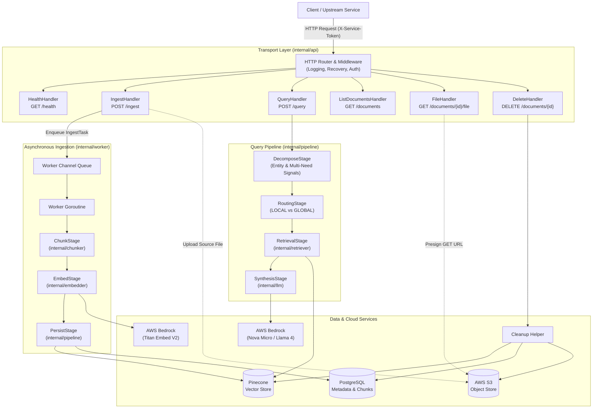
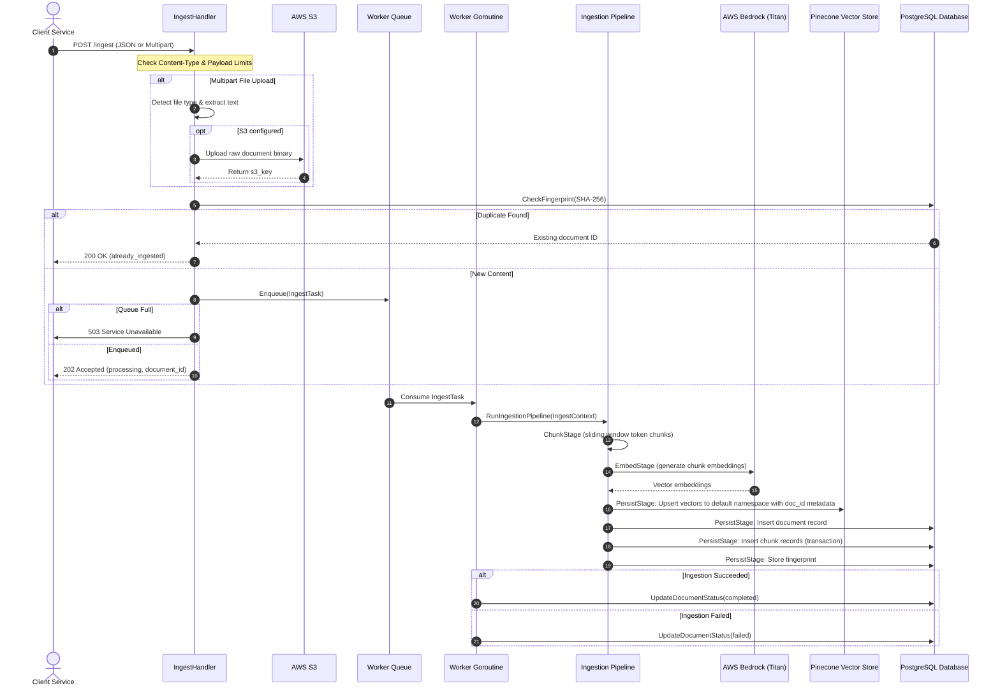
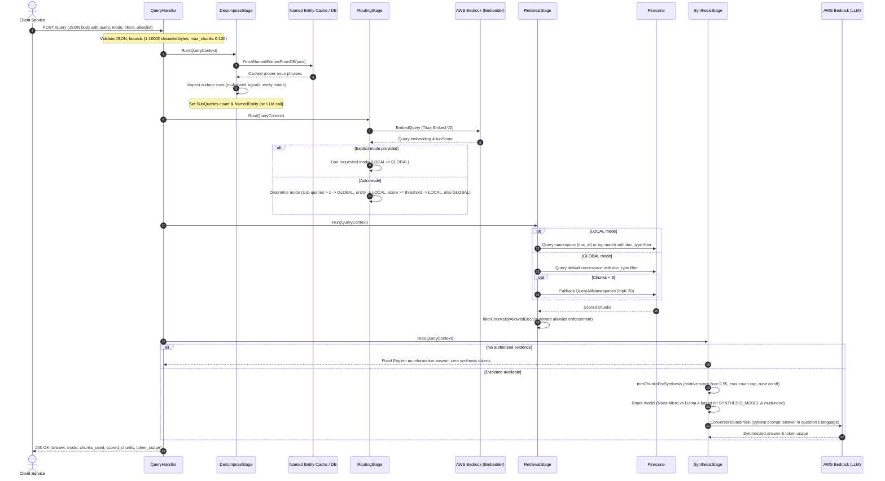
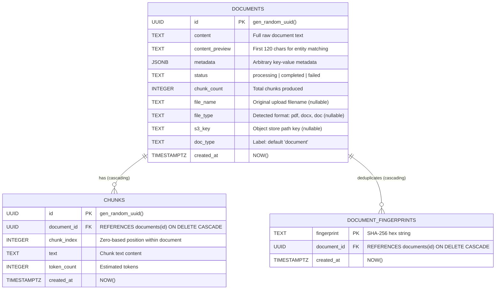

# Architecture

## System Components

Quarry organizes core functionality into distinct packages under `internal/`, wired together at startup by `cmd/server/main.go`.

### Package Responsibilities

- **`cmd/server`**: Reads environment configuration, initializes database connections and storage drivers, instantiates pipeline stages, spawns the background worker, configures HTTP routes, and orchestrates graceful server shutdown.
- **`internal/config`**: Reads and parses environment variables into structured configurations with explicit boundary checks and fallback defaults.
- **`internal/api`**: Configures the HTTP multiplexer and wraps routes with structured JSON logging, panic recovery, and constant-time token verification middleware.
- **`internal/api/handler`**: Implements transport handlers translating HTTP requests and responses into domain operations.
- **`internal/api/middleware`**: Provides request logging with execution latency tracking, panic recovery yielding JSON envelopes, and service token enforcement.
- **`internal/chunker`**: Splits raw text into token-bounded segments using a sliding word window, normalizes whitespace, strips HTML elements, and generates content fingerprints.
- **`internal/extractor`**: Extracts plain text from uploaded document formats (PDF, DOCX, DOC, plain text) with context cancellation and XML safety bounds.
- **`internal/embedder`**: Invokes AWS Bedrock Titan Embed V2 to generate 1024-dimensional normalized vector embeddings, throttling concurrent API requests via weighted semaphores. Provides a deterministic fake embedder for offline execution.
- **`internal/llm`**: Manages LLM calls to AWS Bedrock Converse, executing model selection (Nova Micro vs. Llama 4 Maverick), plain-text answer synthesis, token estimation, and JSON retry-correction routines. Provides a fake converser for offline execution.
- **`internal/retriever`**: Executes similarity searches across Pinecone vector namespaces, evaluates similarity scores against thresholds to select LOCAL or GLOBAL search modes, and applies fallback searches if initial results are sparse.
- **`internal/worker`**: Buffers asynchronous document ingestion tasks in an in-memory channel, executing pipeline stages in a dedicated goroutine and tracking status updates in PostgreSQL.
- **`internal/pipeline`**: Encapsulates sequential multi-stage pipelines:
  - **Ingestion Pipeline**: Executes `ChunkStage`, `EmbedStage`, and `PersistStage`.
  - **Query Pipeline**: Executes `DecomposeStage`, `RoutingStage`, `RetrievalStage`, and `SynthesisStage`.
- **`internal/store/postgres`**: Manages PostgreSQL connection pooling via `pgxpool`, applies embedded SQL migrations, and performs transactional CRUD queries on documents, chunks, and fingerprints.
- **`internal/store/pinecone`**: Implements vector storage drivers for Pinecone, managing index connection pooling across namespaces, upsert operations, and metadata filtering.
- **`internal/store/s3`**: Uploads source binaries, deletes stored objects, and generates presigned GET download URLs.
- **`internal/cleanup`**: Provides multi-store deletion ensuring external vector and object records are purged before metadata records are removed.
- **`internal/domain`**: Defines shared interfaces, domain data models, and the default document label constant (`DefaultDocType = "document"`).

---

## Ingest Pipeline

The ingest pipeline processes text or binary documents through chunking, embedding, vector storage, and relational persistence.

### Ingestion Stages

1. **ChunkStage**: Converts raw document text into sliding-window text chunks. Words are grouped into windows of `CHUNK_TOKEN_SIZE` (default 512 tokens) with an overlap of `CHUNK_OVERLAP` (default 64 tokens). Generates a deterministic chunk ID for each chunk.
2. **EmbedStage**: Iterates over generated chunks and obtains 1024-dimensional embeddings via AWS Bedrock Titan Embed V2.
3. **PersistStage**:
   - Assigns the caller's `doc_type` or falls back to the default `"document"`.
   - Injects `doc_type` into metadata for both document and individual chunk records.
   - Upserts vectors into Pinecone only under the default namespace (`""`), with `doc_id` metadata identifying each document.
   - Inserts the document record into PostgreSQL, storing the full text, metadata, and an initial 120-rune text preview.
   - Inserts chunk metadata records into PostgreSQL inside a database transaction.
   - Records the SHA-256 content fingerprint in PostgreSQL.

---

## Query Pipeline

The query pipeline executes semantic search and grounded answer generation through four distinct stages: decomposition, routing, retrieval, and synthesis.

### Query Stages

1. **DecomposeStage**: Analyzes query phrasing for multi-need surface signals (comparison keywords, conjunctions, aggregation markers) and matches query terms against cached named entities extracted from document previews. Operates purely through local heuristics without LLM invocation.
2. **RoutingStage**:
   - Generates a vector embedding for the incoming query using Bedrock Titan Embed V2.
   - Evaluates whether to route to `LOCAL` or `GLOBAL` retrieval:
     - If the caller passed an explicit mode (`local` or `global`), that mode is used.
     - If the similarity probe fails, `GLOBAL` retrieval is selected without discarding the query embedding.
     - If multi-need signals produced multiple sub-query requirements, `GLOBAL` mode is selected.
     - If a specific named entity is identified, `LOCAL` mode is selected.
     - If the highest vector similarity score meets or exceeds `LOCAL_RETRIEVAL_THRESHOLD` (default 0.70), `LOCAL` mode is selected.
     - Otherwise, `GLOBAL` mode is selected.
3. **RetrievalStage**:
   - Queries Pinecone using the embedding produced during routing.
   - In `LOCAL` mode, queries the specific document namespace or falls back to default.
   - In `GLOBAL` mode, queries the default namespace. If fewer than 3 chunks are returned, an automatic fallback queries across namespaces up to a limit of 20 chunks.
   - Applies `filter_doc_type` metadata filter when specified.
   - Applies caller-supplied `allowed_document_ids` allowlists, filtering out chunks outside the allowlist prior to synthesis. A nil allowlist allows all documents; an empty allowlist denies all documents.
4. **SynthesisStage**:
   - If no authorized evidence remains, returns `No relevant information was found to answer this question.` with no model call, zero synthesis token usage and `early_exit=true`.
   - Applies adaptive chunk trimming: drops chunks scoring below 55% of the top chunk's score, bounds chunk counts (5 chunks for simple queries, 8 for multi-need queries), and truncates chunk bodies at sentence boundaries near 1200 runes.
   - Selects synthesis model according to `SYNTHESIS_MODEL` (`fallback` defaults to Llama 4 Maverick, `primary` routes to Nova Micro, and `hybrid` dynamically routes based on multi-need detection).
   - Formulates the synthesis prompt with the instruction to answer strictly using retrieved excerpts and in the language of the user's question.
   - Invokes AWS Bedrock Converse only for evidence-backed answers and aggregates synthesis token usage statistics.

---

## Data Model

The relational storage schema is defined across embedded SQL migrations applied in numeric order at service startup.

### Table Definitions

- **`documents`**: Stores primary document records, full content, status lifecycle (`processing`, `completed`, `failed`), extracted prefix preview, file metadata, object storage references, and document labels.
- **`chunks`**: Stores segmented text blocks and approximate token counts linked to parent documents via cascading foreign keys.
- **`document_fingerprints`**: Maps SHA-256 content hashes to document UUIDs, providing deduplication across ingest requests.

---

## Lifecycle and Concurrency Model

### Server Initialization

1. Configuration is loaded and validated against constraints from environment variables.
2. The PostgreSQL connection pool (`pgxpool.Pool`) is established with a 30-second connection timeout.
3. Embedded SQL migrations are discovered by version and applied once in ascending order within a PostgreSQL transaction guarded by an advisory lock. The `schema_migrations` table records versions and checksums; concurrent replicas wait for the lock, and subsequent startups skip applied SQL after verifying checksums.
4. Storage drivers and model clients are initialized:
   - In standard mode: Pinecone index connection pools, AWS Bedrock embedder, AWS Bedrock LLM client, and S3 object storage client.
   - In offline fake mode: In-memory vector store, fake deterministic embedder, and fake converser.
5. Ingestion pipeline stages and worker queue are instantiated, and the worker consumer goroutine is started.
6. The HTTP router and middleware chain are registered with standard network listeners.
7. HTTP server listener begins serving with explicit timeout parameters:
   - Header read timeout: 5 seconds
   - Body read timeout: 30 seconds
   - Response write timeout: 120 seconds
   - Idle keep-alive timeout: 60 seconds

### Worker Queue Mechanics

- The worker queue is backed by an in-memory buffered channel of capacity `WORKER_QUEUE_SIZE` (default 100).
- Handlers enqueue incoming tasks non-blockingly using `select`. If the channel is full, the request returns HTTP 503 and drops the task. If a source file was already uploaded to S3, the handler removes the uploaded object.
- A single worker goroutine sequentially consumes from the channel, running the ingestion pipeline and updating document statuses in PostgreSQL.

### Graceful Shutdown Sequence

1. The process captures OS termination signals (`SIGINT`, `SIGTERM`).
2. An active HTTP server shutdown begins with a 15-second deadline via `http.Server.Shutdown`, stopping new connection acceptance and waiting for in-flight requests to complete.
3. The background worker is stopped via `Worker.ShutdownContext` with a 15-second deadline:
   - The queue channel is closed to reject any further enqueue attempts.
   - Any tasks already buffered in the channel are processed until empty or until context cancellation.
4. Active Pinecone index connections are closed.
5. The PostgreSQL connection pool is closed, waiting for checked-out connections to return.

### Extraction Boundaries

JSON ingestion allows 1,000,000 decoded content bytes and a body cap of 8,097,152 bytes for escaping and metadata. Multipart uploads remain bounded by `MAX_UPLOAD_BYTES`. PDF extraction caps collected text at 1,000,000 bytes and checks relevant decoded streams against a cumulative 8 MiB budget before text parsing; it also bounds source reads, page count, font count, Unicode font-map size and declarations, and stream nesting, with a five-second context deadline. DOCX document XML is bounded at 16 MiB. Extraction-limit failures use HTTP 422.

Failure-status updates use a separate five-second context after task cancellation. Deletion treats missing vector namespaces as completed operations, allowing partial deletions to be retried before metadata is removed.
